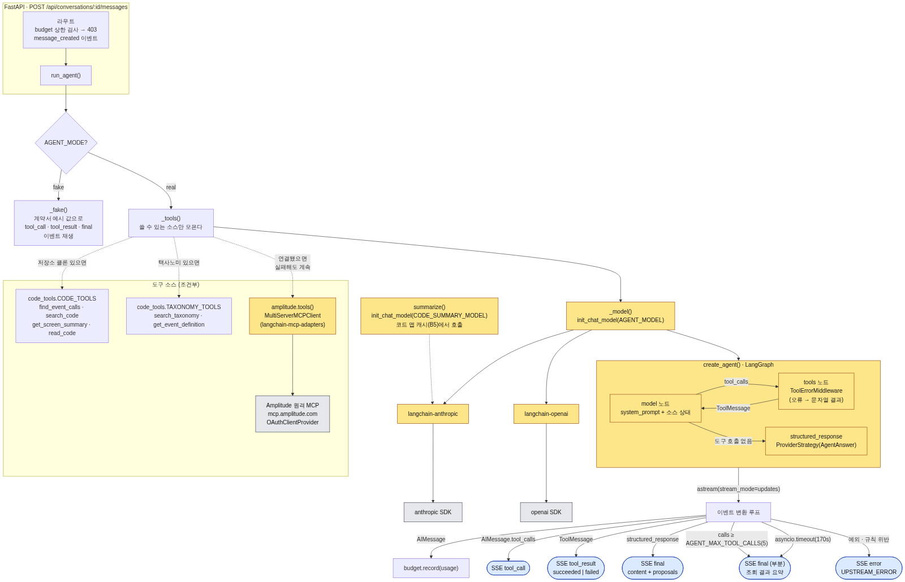
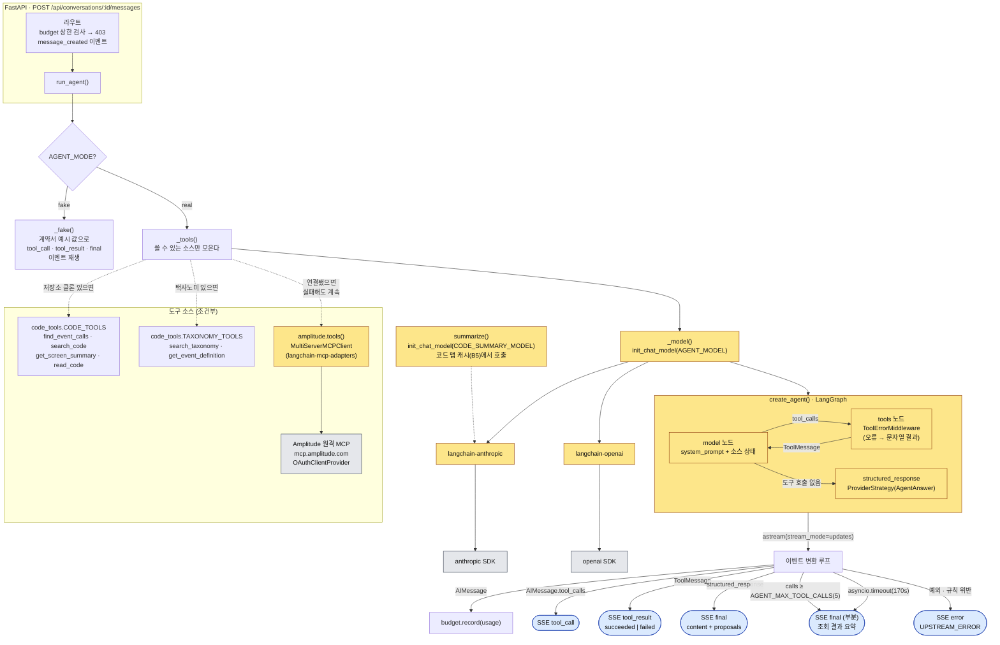

# 에이전트 루프 구성도 — LangChain 기반 (ADR-20 전환 전 기준선)

기준 커밋: `feat/anthropic-sdk-direct` 브랜치의 B9 착수 직전 `backend/app/agent.py`.
ADR-20(공식 SDK 전환) 이후 노란색 노드가 모두 바뀐다. 전환 전 구조를 남겨 두는 기록이다.

- 노란색: LangChain 계열 (제거 대상)
- 파란색: 프론트로 나가는 SSE 이벤트 (계약 v1.1, 변경 없음)
- 회색: 외부 시스템

소스: [`agent-loop-langchain.mmd`](./agent-loop-langchain.mmd)

## 읽는 법

1. 라우트가 예산 상한을 먼저 검사하고 `message_created`를 보낸 뒤 `run_agent()`를 호출한다.
2. `_tools()`는 세 소스 중 **쓸 수 있는 것만** 도구로 모은다. Amplitude가 실패해도 나머지로 답한다(FR-010).
3. `create_agent()`가 만든 LangGraph는 model 노드와 tools 노드를 오가며, 도구 호출이 없는 턴에서 `ProviderStrategy(AgentAnswer)`로 구조화 응답을 낸다. 강제 tool_choice는 쓰지 않는다(현행 Claude 모델이 400).
4. 이벤트 변환 루프가 LangGraph 메시지를 계약서의 SSE 이벤트로 바꾼다. 이 경계면이 ADR-20 전환에서 QA가 글자 단위로 대조하는 지점이다.
5. 도구 호출 20회·170초 상한에 닿으면 조회 결과 요약으로 부분 `final`을, 예외나 스키마 교차 규칙 위반은 `UPSTREAM_ERROR`를 낸다(재시도 없음).
6. `summarize()`는 별도 모델(CODE_SUMMARY_MODEL)로 코드 맵 캐시(B5)에서만 호출된다.

## ADR-20 이후 바뀌는 것

| 노드 | 전환 후 |
|------|--------|
| `init_chat_model` + langchain-anthropic/openai | 모델 접두사로 분기: `anthropic` SDK tool runner / `openai-agents` Agent |
| `create_agent()` LangGraph | 각 SDK의 네이티브 루프 (model↔tools 왕복은 SDK가 수행) |
| `ProviderStrategy(AgentAnswer)` | anthropic: `output_format=AgentAnswer` / openai: `output_type=AgentAnswer` |
| `MultiServerMCPClient` | `mcp` SDK 직접 세션, 두 런타임이 OAuthClientProvider 하나를 공유 |
| 이벤트 변환 루프 | SDK 이벤트를 같은 SSE 이벤트로 매핑. 출력 형식은 그대로 |
